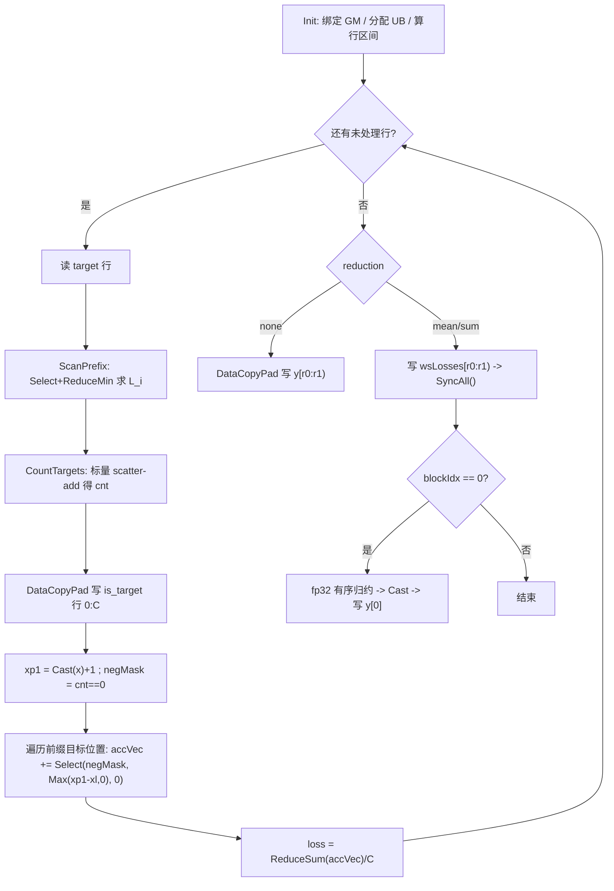

# MultilabelMarginLoss（problem 2327）算子设计文档

> 状态：设计定稿（待评审）。依据本地题包 `MultilabelMarginLoss_problem_2327_template.zip` 与 CANN 8.5.0《Ascend C 算子开发接口参考 / 开发指南》。
> 文档结构对齐 `cann-ops-competitions` 仓 `04_tasks/01_community-task-2026/resources/design_template.md`。
> 本文给出可实施的完整设计：接口契约、Host 校验、Tiling 数值、Kernel 逐步骤、精度/性能验收与测试矩阵。
> 文中标注"题包明确"的结论均可在解包后的 `code/` 下逐行复核；标注"已实测"的期望值已用题包自带 `samples/reference.py` 在本地 Python 跑通验证；标注"待确认 / 须复验"的项未经编译或 NPU 运行，实现阶段须逐条落实，不得当作已验收事实。
> 跨题引用纪律：本文不把 problem 2329 的性能门槛、`Select` / `Compare` 实测结论直接当作本题事实；凡引用处一律标注"须在本题复验"。

---

## 一、需求背景

### 1.1 需求来源

problem 2327 题包提供 `MultilabelMarginLoss` 的 Ascend C 自定义算子工程骨架，含 Host 算子定义、形状推导、Tiling、Kernel、aclnn 调用样例、Python CPU 参考实现与首个 NPU 测试点。OpDef 唯一注册 `ascend910b`，`code/README.md` 说明需 CANN 9.0.0 或 9.1.0 环境。

目标：在保持参考实现可观察语义完全一致的前提下，用 Ascend C 实现双输出算子——逐样本（或归约后）的 multilabel margin loss `y`，以及每个类别在 target 有效前缀中的**出现次数** `is_target`；完成设计、开发、测试，验收通过后提交开源仓（预期 `cann/ops-nn` → `loss/multilabel_margin_loss`）。

### 1.2 对标实现与金标准

对标 910B 内置 TBE 实现 `ops_legacy/dynamic/multilabel_margin_loss.py`（TIK，`data_move_pad` 路径）。题包 `code/samples/reference.py` 已逐行转录其语义，并在文件头注明与 PyTorch / aclnn 文档版本存在**两处实质差异**：

1. **`is_target` 是出现次数，不是 0/1 标记**。dtype 恒为 int32（与 x 的 dtype 无关），内核里就是 `int32 Tensor(dtype_target)`。
2. **每行只处理 target 中第一个 `< 0` 值之前的前缀**；该负值及其后的全部元素不参与计数、也不参与 loss。

参考实现记录的实测观察：行 `[3,2,0,3,0,0]` → `[3,0,1,2,0,0]`；行 `[3,3,3,3,-1,...]` → 类 3 计 4。正是"计数 + 首个负值截断"两条规则的直接体现。

> **金标准优先级（本题唯一裁决）**：`samples/reference.py` > PyTorch / aclnn 文档叙述。任何来源一旦与之冲突，一律以 `reference.py` 为准。按"0/1 标记"实现 `is_target` 会在全部重复标签用例上静默错判，且 `is_target` 的判题容差为 **0**（见 7.1），没有任何容错余量。

浮点口径：TBE 内核一律用 **float32** 中间量（`dtype_input` 恒为 float32），最后按输出 dtype 舍入。

### 1.3 题包现状分析

| 模块 | 现状 | 处置 |
|---|---|---|
| `op_host/..._def.cpp` | 已注册 2 入 2 出、x/y 为 fp32/fp16/bf16、target/is_target 为 int32、ND、`AutoContiguous`、`ascend910b`、`reduction` 可选 string 缺省 `"mean"` | **保留**，补 dtype 与 rank 约束说明 |
| `op_host/..._infershape.cpp` | 无任何校验，按下标直接 `output[i] = input[i]` | **重写** |
| `op_host/..._tiling.cpp` | `totalNum=0`、`blockFactor=1`、`ubFactor=0`、`SetBlockDim(1)`、`WS_SYS_SIZE=0` 全占位 | **重写** |
| `op_kernel/....h` | 全文 TODO；只有 `inputQueueX` / `outputQueueY` 两个 TQue，**没有 target 入队与 is_target 出队** | **重写** |
| `op_kernel/..._tiling_data.h` | 仅 3 个通用字段（`totalNum`/`blockFactor`/`ubFactor`） | **扩展** |
| `op_kernel/..._tiling_key.h` | 两个 `schMode`，位宽声明为 `1` | **扩到 3 个，位宽须同步改为 2** |
| `samples/case.json` | 仅首点：x/target `[4,6]`、fp32/int32、`reduction="mean"` | 保留为端到端基准，另建泛化用例矩阵 |
| `tests/ut/*` | `expectTilingKey=1`、`expectTilingData="0 1 0 "`、`expectWorkspaces={0}` 按占位实现写死 | 随设计同步更新 |

**已定位的模板缺陷（两处，均会导致静默错误结果）**：

1. **InferShape 全错**。`multilabel_margin_loss_infershape.cpp` 的循环使 `output[0](y) = input[0](x) = [N,C]`、`output[1](is_target) = input[1](target) = [N,K]`。正确应为 `y = (reduction=="none") ? [N] : [1]`、`is_target = [N,C]`。首点 `K=C=6` 使 `is_target` 的错误**恰好被掩盖**，而 `y` 的错误立刻暴露（`[4,6]` vs 声明的 `[1]`）。`K≠C` 的泛化用例会同时暴露两者。
2. **bf16 被当作 fp16**。`multilabel_margin_loss_tiling.cpp` 把 `DT_FLOAT16` 与 `DT_BF16` 一并映射到 `MULTILABELMARGINLOSS_TPL_SCH_MODE_0`，而 kernel 该分支实例化的是 `MultilabelMarginLoss<half>`。bf16 与 half 是不同的 16 位格式（8 位指数 vs 5 位指数），走 `half` 实例产生的是**语义错误**而非精度误差。本设计改为 3 个独立 tiling key。

---

## 二、需求分析

### 2.1 数学语义

设 `x` 形状 `[N,C]`（N=batch，C=类别数），`target` 形状 `[N,K]`（K 可不等于 C），`-1` 等负值为 padding。

**第一步：有效前缀**。对每行 `i`，从 `target[i,0]` 向右扫描，在**第一个 `< 0`** 的位置停止，得到有效前缀长度 `L_i`；若整行无负值则 `L_i = K`。

**第二步：计数（is_target）**。只在前缀内，且只统计落在 `[0, C)` 的标签：

```text
cnt[i,t] = | { k : 0 <= k < L_i 且 target[i,k] == t } |,  0 <= t < C
is_target[i,t] = cnt[i,t]        // int32，保留重复次数
```

> **负值与越界正值必须区别对待**：`< 0` 是**终止符**（截断，后续全丢）；`>= C` 的正值只是**无效类别**（跳过本元素，**扫描继续**）。两者混淆会同时污染 `is_target` 与 loss。该规则来自 `reference.py` 中截断（`neg.argmax`）与过滤（`(seg>=0)&(seg<C)`）的**先后顺序**。

**第三步：逐样本损失**。目标类 `l` 满足 `cnt[i,l] > 0`，非目标类 `j` 满足 `cnt[i,j] == 0`：

```text
loss[i] = (1 / C) * Σ_{j: cnt[i,j]==0} Σ_{l: cnt[i,l]>0} cnt[i,l] * max(0, 1 + x[i,j] - x[i,l])
```

等价于"对有效前缀中每个合法标签位置各计一次 hinge"——`cnt[i,l]` 个位置的 `x` 取值相同，故按位置展开与按类别加权完全等价。**本设计的 Kernel 直接利用这一等价性**（见 3.4.4）。

要点：
- 分母是**类别数 C**，不是有效标签数、也不是非目标类数。
- 该行无合法目标类（前缀为空 / 全部越界）→ `loss[i] = 0`；无非目标类（前缀覆盖全部 C 类）→ 内层求和为空 → `loss[i] = 0`。
- 两种 0 值行**仍计入 mean 的分母 N**。

**第四步：归约**。

| reduction | y 的值 | y shape |
|---|---|---|
| `none` | 逐样本 `loss[i]` | `[N]` |
| `mean` | `Σ_i loss[i] / N` | `[1]` |
| `sum`  | `Σ_i loss[i]` | `[1]` |

> `mean`/`sum` 的输出 shape 是 **`[1]` 而不是 rank-0 标量**。`reference.py` 用 `np.atleast_1d` 显式保证，并注明 0 维标量在判题机 `Expect np.ndarray of dtype[shape]` 校验下形状对不上。

### 2.2 接口契约

| 参数 | 方向 | dtype | format | shape | 约束 |
|---|---|---|---|---|---|
| `x` | 输入 | float32 / float16 / bfloat16 | ND | `[N,C]` | rank=2，`N>0`，`C>0` |
| `target` | 输入 | int32 | ND | `[N,K]` | rank=2，batch 维须等于 `x` 的 N；`K` 可 ≠ `C` |
| `reduction` | 属性 | string（OPTIONAL） | — | — | `"none"` / `"mean"` / `"sum"`，缺省 `"mean"` |
| `y` | 输出 | 同 `x` | ND | `[N]` 或 `[1]` | dtype 随 x；shape 按 reduction 推导 |
| `is_target` | 输出 | int32 | ND | `[N,C]` | 每类出现次数，逐元素精确 |

OpDef 用 dtype 列表的**位置索引**绑定 x 与 y 的三种浮点类型，因此不支持混合 dtype；`target`/`is_target` 三个位置均为 int32，与 x 的 dtype 无关。

aclnn 签名（取自 `examples/test_aclnn_multilabel_margin_loss.cpp`，`reduction` 以 C 字符串传入，不是枚举）：

```cpp
aclnnMultilabelMarginLossGetWorkspaceSize(x, target, /*const char* */reduction,
                                          y, is_target, &workspaceSize, &executor);
aclnnMultilabelMarginLoss(workspace, workspaceSize, executor, stream);
```

题包首点：`x=float32[4,6]`、`target=int32[4,6]`（取值范围 `[-1,5)`）、`reduction="mean"` → `y=float32[1]`、`is_target=int32[4,6]`。

### 2.3 需求拆解

1. 重写 InferShape：按 `reduction` 推导 `y`，按 `x` 推导 `is_target`，并补 rank / batch / `C>0` 校验。
2. 按行扫描 target，**首个负值截断**；前缀内 `[0,C)` 的标签累加 int32 计数，越界正值跳过但不截断。
3. 逐行计算 hinge 配对损失，重复标签按出现次数加权，除以 C。
4. 支持 `none` / `mean` / `sum` 三种语义与输出 shape；`mean`/`sum` 输出 `[1]`。
5. 支持 fp32 / fp16 / bf16 三路，**bf16 必须独立实例化 `bfloat16_t`**；`is_target` 恒 int32。
6. 中间计算全程 fp32；**禁止**用半精度算 hinge 或做归约。
7. 控制 UB 占用，**禁止**物化 `[C,C]` pairwise 矩阵；大 C 走分块路径且必须正确（验收用泛化数据）。
8. 多核归约必须**有序**：`mean`/`sum` 经 fp32 workspace + 单核 Finalize，**禁止**向 `y[0]` 无序 `AtomicAdd`。
9. 同步更新 Host UT / Kernel UT fixture，不得为保留占位期望值而不改 tiling。

---

## 三、详细设计

### 3.1 使能方式

通过题包生成的 aclnn 接口调用，参数顺序以生成的 `aclnn_multilabel_margin_loss.h` 为准，不自行更名。构建与运行按 `code/README.md`：

```bash
source /path/to/cann/set_env.sh
bash build.sh -j4                      # 构建 RUN 包
DEVICE_ID=0 bash build.sh -j4 -e       # 构建 + 跑首点 + 比对
NLOHMANN_JSON_INCLUDE_DIR=... GTEST_SOURCE_DIR=... bash build.sh -j4 -u   # 本地 UT
```

### 3.2 Host 侧：OpDef 与 InferShape

#### 3.2.1 OpDef

保留题包声明不变：x/y = `{DT_FLOAT, DT_FLOAT16, DT_BF16}`，target/is_target = `{DT_INT32 ×3}`，format 全 ND，`AutoContiguous()`，`Attr("reduction").AttrType(OPTIONAL).String("mean")`，`AICore().AddConfig("ascend910b")`。

#### 3.2.2 InferShape 与校验（重写）

```text
输入:  x [N, C]      rank 必须为 2
       target [N, K] rank 必须为 2，且 target.N == x.N
属性:  reduction ∈ {"none", "mean", "sum"}，缺省 "mean"
输出:  is_target = [N, C]                       // 取自 x，不是 target
       y = (reduction == "none") ? [N] : [1]    // 不是 [N,C]，不是 rank-0
```

实现要点：

- `reduction` 用**精确字符串比较**，不做前缀/大小写放宽；不在三者之内直接 `GRAPH_FAILED`，不静默回落到 `mean`。
- rank、batch 维、`C>0` 的校验只对**静态已知**维度执行；含动态维（`-1`）时不做数值比较，留给 Tiling 阶段按 storage shape 复核。
- 失败路径一律 `OP_LOGE` + `GRAPH_FAILED`，不允许写出半成品 shape。

#### 3.2.3 Tiling 阶段校验

对实际 storage shape 复核 rank / batch 一致性 / `C>0` / `N>0` / dtype 组合 / `reduction` 合法性。由 `N*C`、`N*K`、tile 字节数推导的整型运算全部用 **int64**，窄化到 API 字段前检查范围。平台信息经 `GetCoreNumAiv()` 与 `GetCoreMemSize(UB, ubSize)` 查询，两者为 0 时报错返回（题包已有该检查，保留）。

### 3.3 Tiling 设计

#### 3.3.1 数据模型与符号

| 符号 | 含义 |
|---|---|
| `N`, `C`, `K` | batch、类别数、target 列数 |
| `coreNum` | `GetCoreNumAiv()`；UT fixture 取 64 |
| `ubSize` | `GetCoreMemSize(UB)`；UT fixture 取 262144，实机以查询值为准 |
| `usedCores` | 实际启用核数 = `min(coreNum, N)` |
| `rowsPerCore` | `CeilDiv(N, usedCores)`，尾核行数可少 |
| `Ca`, `Ka` | `CeilAlign(C, 64)`、`CeilAlign(K, 64)`（64 个 fp32 = 256B） |
| `ubCMax` | 模式 R 可容纳的最大类别数 |

**工作划分的基本单位是"一整行样本"**。loss 依赖同一行内目标类与非目标类的配对关系，且计数依赖前缀的**顺序**，因此：

> **禁止按 K 方向分核做计数或拆前缀**——"首个负值截断"是顺序依赖的，跨核切分前缀后，各核无法独立判断自己这段是否已被更左侧的负值截断。

#### 3.3.2 UB 预算与 `ubCMax`

模式 R（整行常驻）每核需要的主要 buffer（元素宽度均为 4 B）：

| buffer | dtype | 元素数 | 用途 |
|---|---|---|---|
| `xf` | fp32 | `Ca` | x 行升 fp32，预加 `1.0` 后复用 |
| `accVec` | fp32 | `Ca` | 逐类 hinge 累加器 |
| `cnt` | int32 | `Ca` | 计数 / is_target 行 |
| `tmp` | fp32 | `Ca` | hinge 中间量 |
| `negMaskF` | fp32 | `Ca` | `cnt==0` 的 0/1 掩码（或等价 mask 位） |
| `tgt` | int32 | `Ka` | target 行 |

```text
bytesPerRow ≈ 20 * Ca + 4 * Ka        (+ 双缓冲时 target 再加 4 * Ka)
ubCMax = FloorAlign( (ubSize - UB_RESERVE) / BYTES_PER_CLASS , 64 )
```

取 `BYTES_PER_CLASS = 24`（含 K≤C 时的 target 与余量）、`UB_RESERVE = 8192`：

- `ubSize = 262144` → `ubCMax ≈ 10581`
- `ubSize = 196608` → `ubCMax ≈ 7850`

> 本设计取**保守常量 `ubCMax = 8192`** 作为模式切换阈值，并在 Tiling 中按实测 `ubSize` 重算取 `min`，**不写死**。已知的大用例 `[512, 4096]` 落在模式 R 内。
>
> `UB_RESERVE = 8192` 与 256B 对齐这两条来自 problem 2329 在 Atlas A2 上的实测记录，**本题须用编译器资源报告与 CPU UT 复验后才能作为定论**，不得直接套用。

#### 3.3.3 两种遍历模式

**模式 R（Resident，`C <= ubCMax`）**——主路径，覆盖 P0/P1 的全部验收用例：
整行 `x`、`cnt`、`accVec` 常驻 UB；target 行一次或分块读入；按前缀位置遍历，每个合法目标类对全行做一次向量 hinge 并累加进 `accVec`；行末一次 `ReduceSum`。

**模式 T（Tiled，`C > ubCMax`）**——泛化兜底，保证正确性优先于速度：
以 `is_target` 的 GM 行**本身**作为 `cnt` 的载体（它是算子输出，本就要写），分两趟：

1. **计数趟**：对每个类别分块 `[c0, c0+Ct)`，扫描本行有效前缀，只累加落在该区间的标签，块末写出 `is_target[i, c0:c0+Ct]`。代价 `O(ceil(C/Ct) * L_i)` 标量操作。
2. **损失趟**：外层滑动**非目标类块**（从 GM 回读 `x` 块与 `is_target` 块构造 `cnt==0` 掩码），内层遍历有效前缀的目标位置累加 hinge。

> 无论哪种模式，**都不物化 `[C,C]` pairwise 矩阵**：临时空间与 tile 成正比，而非与 `C²` 成正比。

#### 3.3.4 分核

```text
usedCores  = min(coreNum, N)
rowsPerCore= CeilDiv(N, usedCores)
blockIdx 核负责行区间 [blockIdx * rowsPerCore, min(N, (blockIdx+1) * rowsPerCore))
SetBlockDim(usedCores)
```

每核**独占**其行区间的 `is_target` 行写回与 `loss` 计算，核间无写冲突。小 shape（如首点 `N=4`）只启用 4 核，不为占满核数去切 `C`——切 C 会把无冲突的行所有权变成跨核归约，得不偿失。

#### 3.3.5 TilingData 结构（扩展）

```cpp
struct MultilabelMarginLossTilingData {
    int64_t n            = 0;   // batch
    int64_t c            = 0;   // 类别数
    int64_t k            = 0;   // target 列数
    int64_t usedCores    = 1;   // 实际启用核数，与 SetBlockDim 一致
    int64_t rowsPerCore  = 1;   // 每核行数上限（尾核可少）
    int64_t classTile    = 0;   // 模式 T 的类别块长；模式 R 置为 c
    int64_t targetTile   = 0;   // target 分块长度；可容纳整行时置为 k
    int32_t reduction    = 1;   // 0=none, 1=mean, 2=sum
    int32_t schMode      = 1;   // 与 tilingKey 一致，便于 UT 断言
};
```

`reduction` 作为 TilingData 字段而非 key 维度传入，避免 key 数量从 3 膨胀到 9。若后续实测证明运行期分支开销显著，再评估升格为 key 维度。字段变更后 **Host UT 的 `expectTilingData` 与 Kernel UT 的 tiling fixture 必须同步更新**。

#### 3.3.6 TilingKey（扩到 3 个）

```c
#define MULTILABELMARGINLOSS_TPL_SCH_MODE_0 0   // fp16
#define MULTILABELMARGINLOSS_TPL_SCH_MODE_1 1   // fp32
#define MULTILABELMARGINLOSS_TPL_SCH_MODE_2 2   // bf16

ASCENDC_TPL_ARGS_DECL(
    MultilabelMarginLoss,
    ASCENDC_TPL_UINT_DECL(schMode, 2, ASCENDC_TPL_UI_LIST,     // 位宽 1 -> 2
        MULTILABELMARGINLOSS_TPL_SCH_MODE_0,
        MULTILABELMARGINLOSS_TPL_SCH_MODE_1,
        MULTILABELMARGINLOSS_TPL_SCH_MODE_2));
```

> **易漏点**：`ASCENDC_TPL_UINT_DECL` 的第二个参数是**位宽**，题包为 `1`。取值扩到 `{0,1,2}` 后位宽必须改为 `2`，否则 `schMode=2` 无法编码。`ASCENDC_TPL_SEL` 的列表同步补 `MODE_2`，`multilabel_margin_loss.cpp` 增加第三个 `if constexpr` 分支实例化 `MultilabelMarginLoss<bfloat16_t>`。位宽参数语义以目标 CANN 版本的 `template_argument.h` 为准（**须复验**）。

Host 侧 dtype → key 映射改为三分支：`DT_FLOAT16 → 0`、`DT_FLOAT → 1`、`DT_BF16 → 2`，其余 dtype 返回失败。

#### 3.3.7 Workspace

| reduction | workspace | 说明 |
|---|---|---|
| `none` | `0` | 每核直接写自己的 `y[r0:r1)`，无跨核汇总 |
| `mean` / `sum` | `CeilAlign(N * sizeof(float), 512) + WS_SYS_SIZE` | fp32 `losses[N]` 中转，供 Finalize 有序归约 |

workspace 永远是 **fp32**，与 x 的 dtype 无关——半精度中转会在大 N 下直接丢精度。

### 3.4 Kernel 设计

#### 3.4.1 结构

```cpp
template <typename T>   // T ∈ {float, half, bfloat16_t}
class MultilabelMarginLoss {
    __aicore__ inline void Init(GM_ADDR x, GM_ADDR target, GM_ADDR y,
                                GM_ADDR is_target, GM_ADDR workspace,
                                const MultilabelMarginLossTilingData* t);
    __aicore__ inline void Process();
private:
    __aicore__ inline int64_t ScanPrefix(int64_t row);          // 返回 L_i
    __aicore__ inline void    CountTargets(int64_t row, int64_t len);
    __aicore__ inline float   RowLoss(int64_t row, int64_t len);
    __aicore__ inline void    FinalizeReduce();                 // 仅 mean/sum，单核
};
```

> 题包骨架只有 `inputQueueX` / `outputQueueY` 两个队列，**必须补 target 的输入队列与 is_target 的输出队列**；`Init` 的形参表也要加 `workspace`（题包 kernel 入口已有该参数，只是未透传给 `op.Init`）。

#### 3.4.2 Init

绑定 `inputGMX`（T）、`inputGMTarget`（int32）、`outputGMY`（T）、`outputGMIsTarget`（int32）、`wsLosses`（float）。按 `blockIdx` 算出本核行区间 `[r0, r1)`。按 3.3.2 的预算一次性分配 UB buffer。`accVec` 在每行开始处 `Duplicate(0.0f)`。

#### 3.4.3 前缀扫描（`ScanPrefix`）

目标：求 `L_i` = 第一个 `< 0` 的下标，无负值则 `K`。向量化做法，避免 K 次标量比较：

```text
load tgt[0..Ka)                        // 尾部 padding 填 0（非负），不会造成假截断
idxVec[k] = k                          // 常驻常量，Init 时用 CreateVecIndex 生成一次
selVec    = Select(tgt < 0, idxVec, K) // 负值位置给下标，其余给 K
L_i       = ReduceMin(selVec[0..K))    // 第一个负值的下标；全非负则为 K
```

两个硬性细节：

- 尾部对齐 lane 必须填**非负值**（如 0），否则会被误判为截断点，把 `L_i` 砍短。
- `ReduceMin` 只能覆盖 `[0, K)` 的有效范围，`[K, Ka)` 的 padding 不得参与。

> `Select` 在 Atlas A2 上的 mask 极性、dst 不得与 src 重叠、256B 对齐这三条约束来自 problem 2329 的实测记录。**本题必须用 CPU UT（用例 B03）重新锁定**，不得直接引用。

#### 3.4.4 计数（`CountTargets`）

前缀内的标签 → 类别计数，是一个 **scatter-add（直方图）**，没有通用向量指令可用。P0 采用标量回路：

```text
Duplicate(cnt[0..Ca), 0)
for k in [0, L_i):
    t = tgt.GetValue(k)
    if (0 <= t && t < C):  cnt.SetValue(t, cnt.GetValue(t) + 1)
写出 is_target[row, 0:C]   // DataCopyPad，按 C*4 字节精确写
```

复杂度 `O(L_i)` 标量操作，与 TBE TIK 实现同量级。条件 `0 <= t < C` 必须写成**跳过**而非跳出——越界正值不截断（2.1）。

#### 3.4.5 行损失（`RowLoss`）

利用 2.1 的等价性，**按前缀位置遍历**可天然实现 `cnt[l]` 加权，无需显式乘权重：

```text
xf      = Cast<float>(x[row, 0:C])        // fp16/bf16 升 fp32；fp32 直接用
xp1     = xf + 1.0f                       // 每行只算一次
negMask = (cnt == 0)                      // 非目标类掩码，每行只算一次
Duplicate(accVec, 0.0f)

for k in [0, L_i):
    l = tgt.GetValue(k)
    if (l < 0 || l >= C) continue
    xl   = xf.GetValue(l)                 // 标量
    tmp  = xp1 - xl                       // 向量：1 + x[j] - x[l]
    tmp  = Max(tmp, 0.0f)                 // hinge
    tmp  = Select(negMask, tmp, 0.0f)     // 只保留 cnt[j]==0 的 j
    accVec += tmp                         // 向量累加，不在循环内做 ReduceSum

loss = ReduceSum(accVec[0:C]) / (float)C
```

设计理由：

- **循环内只有向量加，没有归约**。把 `ReduceSum` 提到行末只做一次，省掉 `L_i - 1` 次昂贵的跨 lane 归约。
- **`Select` 置零而非依赖数值**：目标类 `j` 自身的 `max(0, 1 + x[l] - x[l]) = 1 > 0`，若不显式屏蔽会凭空多加 `L_i` 份贡献。这是本算子最容易写错的一处。
- **除以 C 放在行末**，不与 mean 的 `/N` 合并。`Σpairs/(N*C)` 在实数域等价、在 fp32 下不等价；**未对拍前禁止融合**。
- 复杂度 `O(L_i * C)` 向量运算，GM 流量 `O(C + K)`——x 行只读一次。
- **P1 优化**：改为遍历 `cnt>0` 的**互异类别** `D` 个（`D <= min(L_i, C)`），循环体末尾加一次 `Muls(tmp, cnt[l])`。重复标签多时 `D << L_i`，收益直接。改前须用 F04/F05 用例确认与 golden 一致。

#### 3.4.6 数值路径与三种 dtype

| 阶段 | 精度 |
|---|---|
| x 读入 | fp16/bf16 → `Cast` 升 fp32；fp32 直通 |
| `+1`、减法、hinge、`Select`、`accVec` 累加、`ReduceSum`、`/C` | **全程 fp32** |
| 跨行归约（mean/sum）与 workspace | **全程 fp32** |
| 写 `y` | fp32 → `Cast` 回 T（RNE） |
| `cnt` / `is_target` | **全程 int32**，不经任何浮点转换 |

> **禁止**用半精度算 hinge 或做归约；**禁止**让 bf16 走 `half` 实例（1.3 缺陷 2）。

#### 3.4.7 归约与写回

**`reduction == "none"`**：本核把 `[r0, r1)` 的 loss 攒在 UB，区间处理完后用一次 `DataCopyPad` 写 `y[r0:r1)`，字节数 = `(r1-r0) * sizeof(T)`。

> **窄写纪律**：`y` 是 `[N]` 的一维张量，行区间边界几乎必然不落在 32B 边界上。若用整 block `DataCopy` 写出，会把邻核负责的 `y` 元素一并覆盖成脏数据，且这种竞态**在小 N 的首点上测不出来**。必须用 `DataCopyPad` 按精确字节数写。GM 非对齐起始地址在目标 CANN 版本上的支持情况**须复验**；若不支持，退化为每核先写 workspace、再由 Finalize 统一拼出 `y`。

**`reduction == "mean" / "sum"`**：

```text
阶段 1（全核并行）: 每核把自己 [r0,r1) 的 fp32 loss 写入 wsLosses[r0:r1)
                    AscendC::SyncAll()              // 跨核屏障
阶段 2（仅 blockIdx==0）: 顺序读回 wsLosses[0:N) 分块 ReduceSum（fp32）
                    total = Σ losses[i]
                    y[0]  = Cast<T>( reduction==mean ? total / N : total )
```

> **禁止向 `y[0]` 做无序 `AtomicAdd`**：浮点加法不满足结合律，多核竞争下结果**逐次运行都可能不同**，无法复现、无法对拍，半精度下还会叠加舍入抢写。单核 Finalize 的代价是 `O(N)` 的一次扫描——相对 `O(N*L*C)` 的主计算可以忽略。
>
> **禁止各核先算自己的 mean 再平均**：各核行数不等（尾核更少），分段平均再平均 ≠ 全局平均。
>
> `SyncAll()` 在目标 CANN 版本上的可用性与开销**须复验**；若受限，退化为 P0 的单核路径（`usedCores=1` 跑完全部行），正确性不变、吞吐下降，并在 DEC 中记录。

#### 3.4.8 流程图



#### 3.4.9 与 TBE 实现的差异点及原因

| 点 | 内置 TBE | 本设计 | 原因 |
|---|---|---|---|
| 行内归约顺序 | TIK 逐元素累加 | `accVec` 向量累加 + 行末单次 `ReduceSum` | 省 `L_i-1` 次跨 lane 归约；树形归约的误差累积也更小 |
| 跨行归约 | — | fp32 workspace + 单核有序 Finalize | 可复现、可对拍；排除无序 atomic |
| golden 累加精度 | fp32 | fp32 | `reference.py` 行内用 `sum(dtype=float64)`；**本设计对齐 TBE 的 fp32**，不追 numpy64 逐位一致（见 3.5 与 7.1） |

### 3.5 性能分析

**复杂度**：每行向量运算量 `O(L_i * C)`（P1 后为 `O(D_i * C)`），标量计数 `O(L_i)`；GM 流量每行 `O(C + K)` 读 + `O(C)` 写。`mean`/`sum` 额外 `N*4` 字节 workspace 往返。无 `C²` 中间张量。

**优化次序**：

1. **正确性优先**：先锁死截断/计数/掩码极性/尾块，再谈性能。
2. **行末单次归约**（本设计已含）：把 `ReduceSum` 提出 hinge 循环，是主要收益来源。
3. **互异类别遍历**（P1）：`D << L_i` 时直接减少循环次数，需 `Muls` 加权并对拍。
4. **按 N 全核 + 双缓冲**（P1）：target 行的 CopyIn 与上一行的 Compute 重叠。
5. **分核粒度**：`usedCores = min(coreNum, N)`，小 N 不启空核。

> **小 shape 的边际收益说明**：题包首点 `[4,6]`（fp32 仅 96 B/张量）只有 4 行、6 类，kernel 启动与 tiling 调度远大于搬运与计算，任何 UB / 双缓冲优化在此规模上都测不出差别。性能只在大 N / 大 C 用例上评估，首点仅作正确性基准。
>
> **性能门槛状态**：同系列题的惯例是"全核场景不低于原 TBE 95%"，但 **problem 2327 的正式条文本地题包未提供，尚未核对**。设计阶段不写死验收耗时、不填造倍率、不写 PASS 结论；实测须在指定硬件与 CANN 版本上、与**同机内置 TBE** 对比后回填，并保留原始日志。

---

## 四、支持硬件

| 芯片版本 | 是否勾选 | 说明 |
|---|---|---|
| Atlas A2 训练系列产品 / Atlas 800I/T A2（Ascend 910B） | √ | 题包默认构建目标与 OpDef 唯一注册项（`AddConfig("ascend910b")`） |
| Atlas A3 / Ascend 950 | | 根 CMakeLists 列出可选 compute unit，但**未注册、未实现、未验证**；提交前须与注册项统一 |

---

## 五、算子约束限制

1. `x` 与 `target` 必须是二维 ND Tensor，batch 维相同；`N > 0`、`C > 0`。
2. `K` 允许不等于 `C`（`reference.py` 独立取 `K = target.shape[1]`）。
3. target 中**首个 `< 0` 的值截断该行**；前缀内 `>= C` 的正值跳过但**不**截断。
4. target 标签允许重复；`is_target` 记录**精确出现次数**（非 0/1），loss 按次数加权。
5. `reduction` 只接受 `"none"` / `"mean"` / `"sum"`，缺省 `"mean"`；`mean`/`sum` 的 `y` shape 为 `[1]` 而非 rank-0 标量。
6. `y` 的 dtype 与 `x` 严格一致；`is_target` 恒为 int32，与 `x` 的 dtype 无关。
7. 不支持混合 dtype（由 OpDef 列表索引对齐保证）。
8. `is_target` 用 int32 计数，要求单行单类的出现次数不超过 int32 上限；真实张量尺寸远低于该上限。
9. 输入/输出按 ND 连续访问；非连续场景依赖 OpDef 的 `AutoContiguous()`，须在外层接口测试确认。
10. **空输入未定义**：`N=0` 时 `reference.py` 的 `np.mean([])` 产生 NaN 并告警，题包未声明是否支持。本设计要求 `N > 0`，建议 Host 对 `N=0` 明确拒绝或直接返回成功且不启动 kernel，**以正式题目输入范围为准**。`K=0`（无标签行）在语义上等价于空前缀 → `is_target` 全 0、`loss=0`，但框架是否允许 0 维输入须确认。
11. **已知性能边界**：模式 T（`C > ubCMax`）为泛化兜底路径，计数趟需对类别块重复扫描前缀，复杂度随 `ceil(C/Ct)` 线性上升。正确性不受影响，列为后续优化项。

---

## 六、特性交叉分析

- **重复标签 × loss 加权**：重复标签既增加 `is_target` 计数，也线性增加该目标类的 hinge 贡献。二者**必须来自同一次前缀扫描**——分别扫描两遍一旦截断点算法不一致，会出现 `is_target` 对而 loss 错的"半错"结果，且 `is_target` 的 0 容差先报错，容易把问题误判在计数上。
- **padding 负值 × 越界正值**：前者是终止符，后者是无效类别。本设计在 `CountTargets` 与 `RowLoss` 两处都写成"跳过"而非"跳出"，并由用例 F06 专门锁定。
- **reduction × 输出 shape × 分核**：`none` 下各核独占行区间可无冲突并行；`mean`/`sum` 需跨 N 汇总，必须经 workspace + `SyncAll` + 单核 Finalize。三种 reduction 共用同一套行计算，只在写回阶段分叉。
- **低精度 × 计数输出**：fp16/bf16 只影响 loss 数据路径，`target`/`is_target` 恒 int32。bf16 必须实例化 `bfloat16_t`——走 `half` 产生的是语义错误而非精度误差，且在 `|x| < 65504` 的常规取值下**不会溢出报错，只会静默算错**。
- **大 C × UB 容量**：`C` 直接决定模式 R/T 的切换。阈值 `ubCMax` 必须由 Tiling 按实测 `ubSize` 计算，写死常量会在不同 UB 规格的芯片上要么浪费容量、要么溢出。
- **与 PyTorch 生态的交叉**：本算子与 `torch.nn.MultiLabelMarginLoss` **同名不同义**（`is_target` 的计数 vs 0/1）。若后续接入 PyTorch 适配层，不能直接把该层的期望值当 golden。

---

## 七、可维可测分析

### 7.1 精度标准 / 性能标准

| 验收标准 | 描述 | 标准来源 |
|---|---|---|
| 输出 shape / dtype | 与 `case.json` 及 reduction 契约完全一致；判题机严格校验输出文件**字节数**与 dtype（`exact byte size mismatch`） | 题包 `samples/sample.py` |
| `is_target` 精度 | `rtol=atol=tol=0` → 整数路径走逐元素 `a == b`，再判 `bad <= tol * size = 0`，即**必须逐元素完全相等，零容错** | 题包 `case.json` + `sample.py` |
| `y` 精度 | 首点 fp32 `[1]`：`rtol=atol=tol=1e-4`，`equal_nan=True`；容差按**不匹配元素占比**判定（`bad <= tol * size`）。`size=1` 时 `tol*size = 1e-4 < 1`，故**该元素必须落在 rtol/atol 之内**，占比容差不提供任何额外余量 | 题包 `case.json` + `sample.py` |
| 低精度 / 隐藏用例 | 题包未提供 fp16/bf16 与隐藏用例的容差表，**以 problem 2327 正式任务书为准** | 待确认 |
| 性能标准 | 不低于同机内置 TBE。同系列惯例为全核场景 95%，**本题正式条文未核对**；先报告实测 AICore 时间与基准，不写 PASS | 待确认 |

首点的 `1e-4` 只约束该点，**不代表** fp16/bf16 或隐藏用例的统一标准。

> **大 C 的精度仲裁口径**：`reference.py` 行内用 `sum(dtype=np.float64)`，本设计用 fp32。`C=4096` 量级下两者可能出现超过 `1e-4` 相对误差的边界点。**裁决：对齐内置 TBE 的 fp32 行为，用同机 TBE 作仲裁**，不为追 numpy64 逐位一致而改算法。若正式判题确以 numpy64 为 golden，再按 7.3 第 5 条处理。

### 7.2 测试矩阵

| ID | 类别 | 关键输入 | 验证性质 |
|---|---|---|---|
| F01 | 基础 | 题包首点 fp32 `[4,6]`、target `[4,6]`、mean | 两输出与 `reference.py` 一致；`y` 为 `[1]` |
| F02 | reduction | 同输入分别 none / mean / sum | `none → y[N]`；mean/sum → `y[1]` 且**非 rank-0** |
| F03 | dtype | 同 shape 的 fp32 / fp16 / bf16 | 三个 kernel 实例；输出 dtype 逐字节正确；**bf16 不得走 half 位型** |
| F04 | 重复标签计数 | 行 `[3,2,0,3,0,0]`，C=6 | **已实测** `is_target = [3,0,1,2,0,0]` |
| F05 | 截断 | 行 `[3,3,3,3,-1,-1]`，C=6 | **已实测** `is_target = [0,0,0,4,0,0]`；`-1` 及其后全部不参与计数与 loss |
| F06 | 越界正值 | C=4，行 `[5,1,4,2]` | **已实测** `is_target = [0,1,1,0]`——`5`/`4` 跳过但**不截断** |
| F07 | 空正类 | 两行：`[0,-1,-1,-1]` 与 `[-1,-1,-1,-1]`，`x=[1,2,3,4]` | **已实测** `none → [2.25, 0.0]`，`mean → [1.125] = 2.25/2`：空前缀行 loss=0 但**仍计入 mean 的分母 N** |
| F08 | 全类为目标 | 前缀覆盖全部 C 类 | 无非目标类 → `loss=0`；计数仍精确 |
| F09 | hinge 边界 | 构造 `1+x[j]-x[l]` 分别 `<0` / `==0` / `>0` | 分别贡献 0 / 0 / 正值；锁死 `Max(·,0)` 与 `Select` 极性 |
| F10 | `K ≠ C` | `x[N,C]`、`target[N,K]`，`K<C` 与 `K>C` 各一 | **已实测** `x[1,5]`+`target[1,2]` → `is_target` 为 `(1,5)=[N,C]`、`y` 为 `(1,)=[N]`；**专杀 InferShape 缺陷 1** |
| F11 | 大类别数 | `[512, 4096]`，含稀疏/重复目标 | 模式 R 内无 UB 溢出；尾块正确；记录耗时 |
| F12 | 模式切换 | `C` 跨 `ubCMax` 前后各一（模式 R / 模式 T） | 两模式结果一致，无漏写/重写 |
| F13 | 分核边界 | `N=1`、`N=coreNum`、`N=coreNum+1`、`N` 为大值 | 尾核行数更少时结果正确；mean 分母恒为 N |
| Q01 | 非法 rank | `x` 或 `target` 非二维 | InferShape / Tiling 明确失败 |
| Q02 | batch 不匹配 | `x.N != target.N` | 明确失败，不越界读写 |
| Q03 | 非法 reduction | 不在三者之内的字符串 | 明确失败，**不静默回落 mean** |
| Q04 | 空输入 | `N=0`、`K=0` | 按 5.10 的裁决执行；不得崩在 tiling |
| B01 | 特殊值 | `x` 含 NaN / ±Inf | 与 golden 一致（`equal_nan=True`）；列为 NPU 复测项 |
| B02 | 尾块 | `C`、`K` 不是 32B / 向量对齐整倍数 | 不越界；padding lane 不污染有效结果 |
| B03 | 掩码极性 | 小用例锁 `Select(negMask, ·, 0)` 与 `ScanPrefix` 的 `Select` 方向 | 以最低成本锁死 src0/src1 方向与 mask 极性（2329 结论在本题复验） |
| B04 | 窄写越界 | `none` 模式下 `N` 使各核行区间不落 32B 边界 | 邻核 `y` 元素不被覆盖；**整 block 写会在此用例暴露** |
| P01 | 性能 | 小 `[4,6]`、大 N、大 C、三种 reduction | 同环境与内置 TBE 对比，保存原始日志 |

### 7.3 验证方法与交付记录

1. **Host UT**（`tests/ut/op_host`）：覆盖合法/非法 shape、三种 dtype 的 tilingKey、三种 reduction 的 `y` shape、TilingData 各字段、`blockDim`、workspace 大小。现有期望值 `expectTilingKey=1`、`expectTilingData="0 1 0 "`、`expectWorkspaces={0}` 是占位值，**必须随设计更新**；不得为保留这三个值而不改 tiling。
2. **Kernel CPU UT**（`tests/ut/op_kernel`）：用 `tikicpulib` 跑截断、重复、越界、hinge 边界、尾块、跨核区间；`tilingData` 由 fixture 按 3.3.5 的新字段构造。**优先加 B03**——四元素级别的用例即可锁死 `Select` 极性，是成本最低的一道闸。注意 `code/README.md` 说明内层 kernel UT 默认跳过数值断言（需 `ENABLE_INNER_KERNEL_UT=ON` 开启），**不能把"UT 通过"当作数值已验证**。
3. **NPU 端到端**：`DEVICE_ID=0 bash build.sh -j4 -e` 跑首点 → `sample.py verify`。CPU UT 不替代 NPU 结果。
4. **泛化对拍**：题包 `samples` 只含首点 `[4,6]` mean，F02–F13 全部需自建输入，直接调 `reference.py` 的 `impl(x, target, reduction)` 产 golden。验收用泛化数据，首点通过**不构成**验收依据。
5. **精度分歧的处理**：若大 C 用例上 fp32 与 `reference.py` 的 fp64 累加超差，先确认是否为累加顺序导致，再用同机内置 TBE 仲裁；**不得**为凑 numpy64 而改算法，也不得直接放宽容差。触碰止损时写 DEC 记录。
6. **性能**：在指定硬件与 CANN 版本上采集逐用例 AICore 时间，记录芯片、驱动/CANN 版本、shape、dtype、target 前缀分布、reduction、基线与逐次耗时。无正式阈值前只报告实测值，不写 PASS。

---

## 八、兼容性分析

全新自定义算子，不修改任何内置算子，不涉及存量接口兼容性。算子名 `MultilabelMarginLoss` 与内置 TBE 算子同名；本工程通过自定义算子包与 `ASCEND_CUSTOM_OPP_PATH` 隔离加载（`examples/run.sh` 已按此设置）。若评测环境同时加载内置同名算子，需确认加载优先级——本工程未实现与内置算子的抢占逻辑，依赖自定义算子包的默认优先级。

aclnn 公开接口的参数顺序以生成的 `aclnn_multilabel_margin_loss.h` 为准，不自行更名或调序。

> 需注意：社区仓历史上存在过 `multilabel_margin_loss` 的 Ascend C 版本（曾合入后因兼容性回退）。**不得整段复用该历史实现并当作已验收**；若需参考，只能作为设计佐证，实现仍须按本文逐条落实并重新全量验证。

---

## 九、待确认事项

1. problem 2327 正式题目说明页；隐藏用例的完整 shape / dtype / reduction 组合、`K≠C` 与动态 shape 是否在评分输入范围内。
2. **正式性能条文**：是否沿用同系列的"全核不低于 TBE 95%"，小 shape 是否有豁免口径，以及评分的计时方法。
3. fp16 / bf16 下 `y` 的 rtol/atol，以及 `x` 含 NaN/±Inf 时的规定行为。
4. `N=0` / `K=0` 是否需要支持；若需要，`mean` 在 `N=0` 时的期望值（`reference.py` 当前产出 NaN 并告警）。
5. `AscendC::SyncAll()` 在目标 CANN 版本上的可用性与开销；若受限，`mean`/`sum` 退化为单核路径的大输入性能是否仍满足门槛。
6. `DataCopyPad` 在目标版本上对**非 32B 对齐 GM 起始地址**的支持（决定 `none` 模式能否直接窄写 `y[r0:r1)`，见 3.4.7）。
7. `ASCENDC_TPL_UINT_DECL` 第二参数的位宽语义，确认扩到 3 个 key 时须由 `1` 改为 `2`（见 3.3.6）。
8. `Select` / `Compare` 在 Atlas A2 上的 mask 极性与对齐约束——**本题须用 B03 复验**，不沿用 problem 2329 的结论。
9. 评测 golden 究竟取 `reference.py`（行内 fp64 累加）还是内置 TBE（fp32）——两者在大 C 上可能分歧（见 7.1）。
10. 设计稿与代码的最终提交仓库与路径（预期 `cann/ops-nn` → `loss/multilabel_margin_loss`，待确认）。
