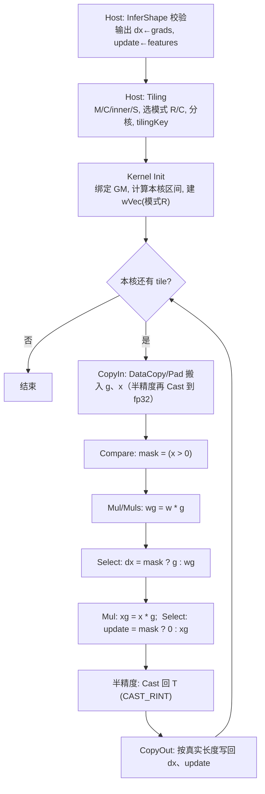

# PReluGradUpdate（problem 2329）算子设计文档

> 状态：设计定稿（待评审）。依据本地题包 `PReluGradUpdate_problem_2329_template.zip` 与 CANN 8.5.0《Ascend C 算子开发接口参考 / 开发指南》。
> 本文件给出可实施的完整设计：接口契约、Host 校验、Tiling 数值、Kernel 逐指令步骤、精度/性能验收与测试矩阵。
> 文档结构对齐 `cann-ops-competitions` 仓 `04_tasks/01_community-task-2026/resources/design_template.md`。
> 文中标注"已实测"的数值结论均用 numpy 在本地验证过；标注"待确认"的项未经编译或 NPU 运行，实现阶段须逐条落实。

---

## 一、需求背景

### 1.1 需求来源

problem 2329 题包提供的 Ascend C 自定义算子工程骨架，含 Host 定义、形状推导、Tiling、Kernel、aclnn 调用样例、CPU 参考实现与首个 NPU 测试点。工程 `build.sh` 默认目标 `ascend910b`，`code/README.md` 说明需 CANN 9.0.0 或 9.1.0 环境。

**接口归属澄清（重要）**：GitCode 社区任务目录 `02-15-PreluGradUpdate` 的现有模板描述的是 **两输入、一输出 `weight_grad`** 接口，且其 `README.md` 参数表把输入错标为 `x`/`y`。本题包是 **三输入 `grads`/`features`/`weights` → 两输出 `dx`/`update`**。两者同名不同义，不能互相套用实现，提交归属须以 problem 2329 的正式平台为准。

### 1.2 对标实现

参考实现为内置 TBE `ops_legacy/dynamic/prelu_grad_update.py`，910B 走 `after_v200` 分支。`code/samples/reference.py` 已逐行转录其语义：

```
broadcast_weight_shape([C]) -> [1, C, 1, ...]      // 通道维 = dims[1]，不是右对齐
zero_one  = features > 0 ? 0 : 1
one_zero  = features > 0 ? 1 : 0
result_dx     = one_zero + zero_one * weights
result_update = zero_one * features
dx     = result_dx     * grads
update = result_update * grads
```

即：

```
dx[n,c,...]     = x > 0 ? g : w_c * g
update[n,c,...] = x > 0 ? 0 : x * g
```

TBE 全程在 **float32** 计算，末尾再按输入 dtype 舍入。`update` 与 `features` **同形、逐元素**，不在本算子内做通道归约（通道归约是另一算子 PreluGradReduce 的职责）。

### 1.3 题包现状分析

| 模块 | 现状 | 处置 |
|---|---|---|
| `op_host/..._def.cpp` | 已注册 3 入 2 出、fp16/fp32/bf16、ND、`ascend910b` | 保留，补 dtype 约束说明 |
| `op_host/..._infershape.cpp` | 无校验，直接 output[i] = input[i] | **重写** |
| `op_host/..._tiling.cpp` | `totalNum=0`、`ubFactor=0`、`blockDim=1` 全占位 | **重写** |
| `op_kernel/...h` | 全文 TODO，两个空 TQue | **重写** |
| `op_kernel/..._tiling_data.h` | 3 个字段 | **扩展** |
| `op_kernel/..._tiling_key.h` | 两个 schMode | **扩到 3 个** |
| `tests/ut/*` | 按占位值写的期望 | 随设计同步更新 |

**已定位的缺陷**：`p_relu_grad_update_tiling.cpp:82` 把 `DT_FLOAT16` 与 `DT_BF16` 都映射到 `PRELUGRADUPDATE_TPL_SCH_MODE_0`，而 kernel 侧该分支实例化的是 `PReluGradUpdate<half>`。bf16 与 half 是不同的 16 位格式（5 位指数 vs 8 位指数），走 `half` 实例会产生**静默错误结果**，不是精度问题而是语义错误。本设计改为 3 个独立 tiling key。

---

## 二、需求分析

### 2.1 数学语义与分支语义

| 输入 x | 分支 | dx | update | 说明 |
|---|---|---|---|---|
| x > 0 | 正 | g | 0 | 精确等于 `g`，无乘法误差 |
| x < 0 | 负 | w_c · g | x · g | |
| x = +0.0 | 负 | w_c · g | +0.0 · g = ±0 | `0 > 0` 为假 |
| x = -0.0 | 负 | w_c · g | -0.0 · g | IEEE：`-0.0 > 0` 为假 |
| x = NaN | 负 | w_c · g | NaN · g = NaN | IEEE 比较对 NaN 恒假；**不可用符号位/位运算判断分支** |
| g = ±Inf, x < 0 | 负 | w·(±Inf) | x·(±Inf) = ∓Inf | **TBE 掩码乘法在此给 NaN，golden 给 ∓Inf**，见 2.2 结论 1 |
| g = ±Inf, x = 0 | 负 | ±Inf·w | 0·Inf = NaN | golden 同样是 NaN（两分支都求值） |
| w = ±Inf, x > 0 | 正 | g | 0 | **TBE 的 `one_zero + zero_one*w` = 1 + 0·Inf = NaN，golden 给 g** |

**关键设计结论 1（分支实现）**：必须用 `Compare + Select` 实现选择，**不能**用 `(x>0?0:1) * x * g` 的掩码乘法。两处反例（均已在 numpy 上实测确认）：
- `x < 0, g = +Inf`：掩码乘法算 `0 * (x*Inf) = NaN`，golden 的 `np.where` 给 `-Inf`。
- `x > 0, w = +Inf`：TBE 的 `result_dx = one_zero + zero_one*w` 算 `1 + 0*Inf = NaN`，golden 给 `g`。

即本题 golden 与 TBE 内置实现在 Inf 输入上**并不同源**，必须按 golden 的 `where` 语义实现。`Select` 天然满足：未被选中的分支不参与数值计算（`Select` 是数据选择，不是算术）。

**关键设计结论 2（精度）**：`dx` 与 `update` 各自只有一个乘法，无累加。fp16 的 11 位有效数相乘得 22 位，在 fp32（24 位）中**精确**，再按 RNE 舍入回 fp16，与"硬件半精度乘法"结果一致。已用 20 万组随机 fp16 与 bf16 输入实测验证：**fp32 计算后 RNE 回写 与 原生低精度乘法，位模式完全一致，0 个差异**。因此 fp16/bf16 路径统一走 fp32 中间精度是位安全的；且 `Select` 在 Atlas A2 上只支持 `half/float`，bf16 本就必须升 fp32。

### 2.2 接口契约

| 参数 | 方向 | dtype | format | shape | 约束 |
|---|---|---|---|---|---|
| `grads` | 输入 | fp16/fp32/bf16 | ND | `[N,C,d2,...,dk]`，rank ≥ 2 | 基准形状 |
| `features` | 输入 | 同上 | ND | 与 `grads` **完全一致** | 同形同 dtype |
| `weights` | 输入 | 同上 | ND | `[C]` 或 `[1]` | 一维；长度必须是 1 或 `dims[1]` |
| `dx` | 输出 | 同上 | ND | 同 `grads` | |
| `update` | 输出 | 同上 | ND | 同 `features` | |

**dtype 绑定方式**：OpDef 中五个参数按列表索引对齐声明 `{DT_FLOAT16, DT_FLOAT, DT_BF16}`，框架按索引匹配，同一索引下所有张量同 dtype。因此**混合 dtype（如 grads=fp16, weights=fp32）不在本算子支持范围内**——这一点由 OpDef 保证，无需额外校验；但实现阶段仍须在 InferShape 中显式复核，避免框架行为变更带来静默错误。

### 2.3 需求拆解

1. 输出 shape/dtype 推导 + 输入一致性校验，非法输入返回明确错误。
2. `weights=[1]`（标量广播）与 `weights=[C]`（通道广播，通道维 = `dims[1]`）两种模式。
3. fp16/fp32/bf16 三条独立 kernel 实例，半精度以 fp32 为中间精度、RNE 回写。
4. 多核划分、UB 分块、32B 对齐尾块、跨通道边界。
5. `update` 逐元素输出，无通道归约。
6. 功能/约束/边界/数值/性能用例与原始日志。

---

## 三、详细设计

### 3.1 使能方式

aclnn 直调（`aclnnPReluGradUpdateGetWorkspaceSize` + `aclnnPReluGradUpdate`）。`op_host/CMakeLists.txt` 在缺少 `op_api/` 目录时自动从 `autogen/aclnn_*.cpp` 生成接口，题包未提供手写 op_api，保持自动生成即可。样例 `examples/test_aclnn_p_relu_grad_update.cpp` 已按 3 入 2 出调用，无需改动。

### 3.2 Host 侧：OpDef 与 InferShape

#### 3.2.1 OpDef

保持 `p_relu_grad_update_def.cpp` 的参数顺序与 dtype 列表不变，仅在注释中标注"同索引同 dtype"与"weights 支持 [1]/[C]"。不改 `AddConfig("ascend910b")`：根 `CMakeLists.txt` 的 `ASCEND_COMPUTE_UNIT` 默认列表还含 `ascend910_93`/`ascend950`，但**注册与验证只覆盖 910B**，提交前须确认评测硬件。

#### 3.2.2 InferShape 与校验

```
InferShapePReluGradUpdate(ctx):
  1. g = ctx->GetInputShape(0); f = (1); w = (2)
     任一为 nullptr -> GRAPH_FAILED
  2. g->GetDimNum() < 2             -> GRAPH_FAILED（参考实现要求 ndim>=2）
  3. *f != *g                       -> GRAPH_FAILED
  4. w->GetDimNum() != 1            -> GRAPH_FAILED
     wLen = w->GetDim(0)
     wLen != 1 && wLen != g->GetDim(1) -> GRAPH_FAILED
  5. *ctx->GetOutputShape(0) = *g   // dx
     *ctx->GetOutputShape(1) = *f   // update
  6. 动态 shape：任一维度为 UNKNOWN_DIM(-1) 时跳过 3/4 的数值比较，
     只保留 rank 与"weights rank==1"校验，不伪造 shape。
```

`dims[1]` 的语义就是通道维 `C`；`weights=[C]` 时按 `[1,C,1,...,1]` 广播，**不是**右对齐广播。若误按末维广播，`[N,C,H,W]` 场景会把权重挂到 `W` 上，是典型静默错误。

### 3.3 Tiling 设计

#### 3.3.1 数据模型与符号

```
M     = prod(dims)                      // 总元素数
C     = dims[1]                         // 通道数
inner = prod(dims[2:])                  // rank==2 时为 1
S     = C * inner                       // 单个 n 的元素数
flat 元素扁平下标 i 的通道: c(i) = (i / inner) % C
```

不需要 workspace（`WS_SYS_SIZE = 0`），不需要 Atomic。

#### 3.3.2 UB 预算与 maxTile

从 `PlatformAscendC` 取 `ubSize`（910B 约 192KB，**不写死**）与 `coreNum`（AIV 核数）。按 dtype 的每元素缓冲系数 `coef` 估算单次 tile 上限：

| dtype 路径 | 缓冲明细（字节/元素） | coef（×BUFFER_NUM=2） |
|---|---|---|
| fp32 | g 4 + x 4 + dx 4 + upd 4 + wVec 4 + mask 1 | 2×21 = **42** |
| fp16 → fp32 计算 | gIn 2 + xIn 2 + gF32 4 + xF32 4 + wVec 4 + wg 4 + xg 4 + dxF32 4 + updF32 4 + dxOut 2 + updOut 2 + mask 1 | 2×37 = **74** |
| bf16 → fp32 计算 | 同 fp16 | **74** |

```
usable   = ubSize * 0.85                       // 预留 TPipe 对齐与临时区
maxTile  = AlignDown(usable / coef, 32 / sizeof(T))
```

样例 `[4,6,8]` fp32：M=192，`usable ≈ 192KB×0.85 ≈ 163KB`，`maxTile ≈ 163840/42 ≈ 3900` 元素 → 一次 tile 覆盖全量（192 < 3900），`blockDim=1`。

注意 `coef` 是保守上界（双缓冲 × 全缓冲同时驻留），实际 `InitBuffer` 按队列逐个申请；若 UB 紧张可把 `BUFFER_NUM` 降为 1 换取更大 tile，但会让 MTE/Vector 失去重叠，仅在小 UB 或大 tile 需求下采用。

#### 3.3.3 两种遍历模式

以 `S` 与 `maxTile` 的关系选择，**权重展开代价被摊薄到 0**：

**模式 R（sample-major，`S ≤ maxTile`）**——首选
```
rowsPerTile = max(1, min(N, maxTile / S))
tileLen     = rowsPerTile * S          // 整 sample，模式在每个 tile 内完全相同
```
`Init` 中一次性构造长度 `tileLen` 的权重向量 `wVec`：对 `c ∈ [0,C)`、`p ∈ [0,rowsPerTile)` 执行
`Duplicate(wVec[p*S + c*inner], w[c], inner)`，共 `rowsPerTile*C` 次。此后**所有 tile 复用同一个 wVec**，per-tile 权重开销为零。

这是本设计的核心优化：把"每 tile 展开权重"变成"整个 kernel 只展开一次"。对 `[4,6,8]` 这类小 inner（inner=8）场景尤其关键——若每 tile 展开，`rowsPerTile=4` 时每核仍要做 4×6=24 次 `Duplicate`；外提后整核只做 24 次，且与 tile 数无关。

**模式 C（channel-major，`S > maxTile`）**
`tileLen = maxTile`，tile 落在单个 sample 内。每 tile 按段展开：
```
idx = s; e = 0
while e < tileLen:
    c   = (idx / inner) % C
    seg = min(inner - idx % inner, tileLen - e)
    Duplicate(wVec[e], w[c], seg)
    idx += seg; e += seg
```
由于 `S > maxTile ≥ tileLen`，段数 `≤ tileLen/inner + 1`。`inner ≥ tileLen` 时只有 1~2 段，代价可忽略；`inner` 很小时段数上升（`inner=1` 最多 `tileLen` 段），该极端情形列为已知限制（见第五章第 7 条）。

**权重标量模式（`wLen == 1`）**：两种遍历模式都跳过 `wVec` 构造，直接用 `Muls(dst, src, w0, count)`。这是 `TilingData.weightsPerChannel = 0` 的运行时分支，**不增加模板实例数**。

#### 3.3.4 分核

```
perCore   = CeilAlign(CeilDiv(M, coreNum), 32 / sizeof(T))   // 32B 对齐
usedCores = min(coreNum, CeilDiv(M, perCore))
模式 R 时 perCore 再向上对齐到 S 的整数倍（若 S*sizeof(T) < 32B 则不做）
```
核 `b` 处理 `[b*perCore, min((b+1)*perCore, M))`，每核内再按 `tileLen` 循环。每个输出元素**恰好一个写者**，无跨核归约，因此不需要 Atomic/workspace。

**核内首尾对齐**：`perCore` 按 32B 对齐后，最末一个核的区间可能超出 `M`，用 `min(..., M)` 截断；该核的最后一个 tile 长度非 32B 整倍数，走 `DataCopyPad`（见 3.4.3）。这是唯一出现非对齐搬运的位置，不要在其他 tile 上启用 Pad 路径。

与同族设计文档一致：优先满核；能均分则大小核无差；不能均分时余量落在前 `formerNum` 个核。

#### 3.3.5 TilingData 结构

```cpp
struct PReluGradUpdateTilingData {
    int64_t totalNum;        // M
    int64_t coreNum;         // 实际启用核数
    int64_t blockFactor;     // 每核元素数（32B/S 对齐）
    int64_t tileLen;         // 单次 UB tile 元素数
    int64_t channelNum;      // C
    int64_t innerSize;       // inner
    int64_t sampleSize;      // S = C*inner
    int64_t weightsPerChannel; // 1 = [C] 通道模式；0 = [1] 标量模式
    int64_t rowsPerTile;     // 模式 R 的 rowsPerTile；模式 C 为 0
};
```
Host 与 Kernel 共用此结构，`tests/ut/op_kernel/p_relu_grad_update_tiling.h` 自动跟随（它 `#include` 该头文件）。

#### 3.3.6 TilingKey

| key | dtype | kernel 实例 | 中间精度 |
|---|---|---|---|
| 0 | DT_FLOAT | `PReluGradUpdate<float>` | fp32 |
| 1 | DT_FLOAT16 | `PReluGradUpdate<half>` | fp32 |
| 2 | DT_BF16 | `PReluGradUpdate<bfloat16_t>` | fp32 |

`p_relu_grad_update_tiling_key.h` 的 `ASCENDC_TPL_UINT_DECL` / `ASCENDC_TPL_SEL` 需同步扩为三项。权重模式不参与 key（运行时字段）。

若后续确认 bf16 需走原生 `Mul`（见 3.5 第 3 条），可再加 key 区分"计算精度"，但 `Select` 在 A2 上不支持 bf16，因此**至少 `dx`/`update` 的选择仍须在 fp32 完成**，加 key 的收益有限，不列为设计目标。

### 3.4 Kernel 设计

#### 3.4.1 结构

`Init → Process(CopyIn → Compute → CopyOut)`，`BUFFER_NUM = 2` 双缓冲，按 `tileLen` 循环。队列：

```
inQueueG    QuePosition::VECIN  ×2   float 或 T
inQueueX    QuePosition::VECIN  ×2
outQueueDx  QuePosition::VECOUT ×2
outQueueUpd QuePosition::VECOUT ×2
wBuf        TBuf<TPosition::VECCALC>  tileLen（或 T）
maskBuf     TBuf<TPosition::VECCALC>  tileLen（uint8）
tmpBuf      TBuf<TPosition::VECCALC>  仅半精度路径
```

#### 3.4.2 Init

1. 五个 `GlobalTensor<T>` `SetGlobalBuffer` 到 GM 首地址（`weights` 长度 `wLen`）。
2. 计算本核 `blockStart = GetBlockIdx() * blockFactor`、`blockLen = min(blockFactor, M - blockStart)`，为 0 直接返回。
3. `InitBuffer` 各队列，深度 2，长度 `tileLen`。
4. 模式 R 且 `weightsPerChannel==1`：构造 `wVec`（见 3.3.3）。
5. 半精度路径：`maskBuf` 与 `tmpBuf` 尺寸按 `tileLen` 申请。

#### 3.4.3 CopyIn

对每个 tile `[s, s+L)`：

```
DataCopy(inG, gradsGm[blockStart + s], L)     // L 为 32B 整倍数时
DataCopy(inX, featuresGm[blockStart + s], L)
若 L 非 32B 整倍数（仅每核最后一个 tail tile 可能）:
  DataCopyPad(inG, ..., {1, L*sizeof(T), 0, 0, 0}, {false, 0, 0, 0})
```
`DataCopyExtParams` 的 `blockLen` 单位为**字节**；GM 侧 `srcStride` 按字节、UB 侧 `dstStride` 按 32B block。实现时以头文件注释与 CPU UT 锁定。
tail tile 在 UB 中补齐到 32B（`Duplicate` 填 0），保证向量指令不越界。

#### 3.4.4 Compute（fp32 路径）

```
// 1) 分支掩码：mask = (x > 0)  —— 必须用浮点比较，NaN/±0 语义才正确
Compare(maskU8, xF32, zeroF32, CMPMODE::GT, L)

// 2) 负向候选：wg = w * g
weightsPerChannel ? Mul(wg, gF32, wVec, L)
                  : Muls(wg, gF32, w0, L)

// 3) dx = x>0 ? g : w*g
Select(dxF32, maskU8, wg, gF32, SELMODE::VSEL_TENSOR_TENSOR_MODE, L)

// 4) update = x>0 ? 0 : x*g
Mul(xg, xF32, gF32, L)
Select(updF32, maskU8, xg, 0.0f, SELMODE::VSEL_TENSOR_SCALAR_MODE, L)
```

**mask 极性**：`Compare` 产出的 mask 置位表示"比较为真"。`Select` 的取值侧（`selMode` 0/1/2 下 src0/src1 谁对应置位 lane）在手册中表述含混，**必须在实现第一步用 4 元素的 CPU UT 锁定**：`x=[1,-1,0,NaN]`, `w=0.5`, `g=[2,4,6,8]` → `dx=[2,2,3,4]`, `update=[0,-4,0,NaN]`（golden 已用 numpy 实算）。

若极性相反，**只交换 `src0`/`src1` 的位置即可**，不要改用 `CMPMODE::LE` 取反——`LE` 会把 NaN 判为真（`NaN <= 0` 为假，但 `!(NaN > 0)` 语义经 `LE` 表达时会引入 ±0 的边界差异），改变分支语义。极性反了会得到"正负互换"的结果，而样例若恰好数值对称则难以发现。

**tail lane 的处理**：UB 中补齐到 32B 的 lane 上算出的值是垃圾，但 `CopyOut` 只写真实元素数，不影响正确性；不要为这些 lane 增加分支判断，那会引入向量指令的非对齐路径。

#### 3.4.5 Compute（fp16 / bf16 路径）

`Select` 与 `Compare` 在 Atlas A2 上只支持 `half/float`，**bf16 不在支持列表**；fp16 虽可原生，但为保证与 golden 的 fp32 计算位一致，两条半精度路径统一：

```
Cast(gF32, gIn<T>, CAST_NONE, L)         // T -> fp32
Cast(xF32, xIn<T>, CAST_NONE, L)
… 同 3.4.4 的 1)~4) …
Cast(dxOut<T>,  dxF32,  CAST_RINT, L)    // fp32 -> T，RNE
Cast(updOut<T>, updF32, CAST_RINT, L)
```

`CAST_RINT` 为四舍六入五成双（round-to-nearest-even）。手册确认的合法组合：`float → half` 与 `float → bfloat16_t` 都支持 `CAST_RINT/CAST_FLOOR/CAST_CEIL/CAST_ROUND/CAST_TRUNC`；而 `bfloat16_t → float` **只支持 `CAST_NONE`**（即直接升精度，无舍入）。题包 kernel UT 里的 `FloatToBFloat16` 用的是**截断**（取高 16 位），与 RNE 不同——bf16 用例的 golden 必须按 RNE 生成，否则会在末位出现系统性偏差。

#### 3.4.6 CopyOut

```
DataCopy(dxGm[blockStart + s], dxOut, L) / DataCopyPad(..., L*sizeof(T))
DataCopy(updateGm[blockStart + s], updOut, L) / DataCopyPad(..., L*sizeof(T))
```
写回必须按**真实元素数**，UB 中补齐的 lane 不得落盘，否则 tail 处会覆盖下一个核的数据。

#### 3.4.7 流程图



#### 3.4.8 与 TBE 实现的差异点及原因

| 差异点 | TBE | 本设计 | 原因 |
|---|---|---|---|
| 分支实现 | `one_zero + zero_one*weights` 掩码乘法 | `Compare + Select` | 掩码乘法在 `g=±Inf, x<0` 与 `w=±Inf, x>0` 两处给 `NaN`，golden 分别是 `∓Inf` 与 `g`（已实测） |
| 中间精度 | 全程 fp32 | fp32（三项统一） | 与 golden 一致；bf16 的 Select 在 A2 不受支持 |
| 回写舍入 | `cast_to` / bf16 用 `round` | `CAST_RINT` | RNE 与 numpy `astype` 一致 |
| 权重展开 | `broadcast_weight_shape` 在图中广播 | 模式 R 一次展开复用；模式 C 分段展开 | Ascend C 无图级广播，需显式构造 UB 向量 |
| 核间划分 | TBE 自动调度 | 显式 32B 对齐连续切分 | Ascend C 需手工 tiling |

### 3.5 性能分析

融合后每元素 GM 流量：读 `g`、读 `x`、写 `dx`、写 `upd` = `4 * M * sizeof(T)` 字节，权重流量可忽略。无 GM 中间张量，无 workspace。复杂度 O(M)，无跨核归约。

优化次序：
1. **正确性优先**：先保证布局、尾块、通道边界、mask 极性正确，再谈性能。
2. **权重展开外提**（本设计已含）：模式 R 下 `wVec` 只构造一次，这是小 inner 的主要收益来源。
3. **半精度路径减少 Cast**：fp16 可优先改为原生 `Select(half)` + `Cast`，省两次 fp32 Cast 与相应 UB；bf16 无原生 Select，仍走 fp32。改前须用 B03/N01 用例确认与 golden 一致。
4. **双缓冲**：`BUFFER_NUM=2` 让 MTE2/MTE3 与 Vector 重叠。
5. **分核粒度**：小 M 时避免启用过多空核（`usedCores = min(coreNum, CeilDiv(M, perCore))`）。

> **小 shape 的边际收益说明**：题包首点 M=192（fp32 仅 768 B/张量），kernel 启动与 tiling 开销远大于搬运与计算，任何 UB/双缓冲优化在此规模上都测不出差别。性能优化只在大 M 用例上评估，首点只作为正确性基准。正式性能门槛题包未提供，设计阶段不写死验收耗时；实测数据须在指定硬件与 CANN 版本上采集后回填。

---

## 四、支持硬件

| 芯片版本 | 是否勾选 | 说明 |
|---|---|---|
| Atlas A2 训练系列产品 / Atlas 800I/T A2（Ascend 910B） | √ | 题包默认构建目标与 OpDef 唯一注册项 |
| Atlas A3 / Ascend 950 |  | 根 CMakeLists 列出但**未实现未验证**，提交前须与注册项统一 |

---

## 五、算子约束限制

1. `grads`/`features` 必须同 shape、同 dtype；`dx` 同 `grads`、`update` 同 `features`。
2. `weights` 必须一维，长度 ∈ {1, `dims[1]`}；不支持任意广播。
3. rank ≥ 2（参考实现 `features must be at least 2-D`）。
4. 不支持混合 dtype（由 OpDef 列表索引对齐保证）。
5. `update` 为逐元素输出，**不做通道归约**。
6. **`w = ±Inf` 且 `x > 0` 时，本实现返回 `g`，与 numpy golden 一致、与内置 TBE 不同**。若正式评测的参考实现改用内置 TBE 而非 numpy golden，此点需重新对齐（见 2.1 结论 1）。
7. **已知性能边界**：模式 C（`C*inner > maxTile`）下若 `inner` 极小（如 `inner=1` 且 `C` 很大），权重展开段数接近 `tileLen`，per-tile 开销上升。正确性不受影响，列为后续优化项（可改为整段 `DataCopy` 权重切片后 `Brcb`/`GatherMask` 展开）。
8. 空张量（`M=0`）未定义：建议 Host 直接返回成功且不启动 kernel，需以正式题目为准。

---

## 六、特性交叉分析

- **与图融合**：本算子为逐元素双输出，可被 GE 识别为 elementwise 类，具备与前置 `PReLU` 前向算子融合的潜力，但融合不在本算子范围内实现。
- **与混合精度训练**：fp16/bf16 输入内部升 fp32 计算，与 AMP 语义一致；输出 dtype 与输入严格一致，满足判题机的逐位 dtype 校验（fp16 输出必须回写为 fp16，题包 `reference.py` 注释记录了此前因返回 fp32 被判题机拒收的事故）。
- **与 PreluGradReduce 的关系**：`update` 的输出正是 PreluGradReduce 的 `updates` 输入；两者通道维定义（`dims[1]`）与 `weights=[1]/[C]` 约定必须一致，否则串联会错位。

---

## 七、可维可测分析

### 7.1 精度标准 / 性能标准

| 验收标准 | 描述 | 标准来源 |
|---|---|---|
| 精度标准 | 与 `samples/reference.py` 逐元素比对；首个测试点 fp32 `[4,6,8]` 给 `rtol=atol=tol=1e-4`，`equal_nan=True`，且容差按**不匹配元素占比**判定（`bad <= tol * size`，不是逐元素阈值）；判题机同时严格校验输出文件字节数与 dtype | 题包 `case.json` + `samples/sample.py` |
| 性能标准 | **不低于 TBE 内置实现**。题包未给具体门槛，先报告实测 AICore 时间与基准，不写 PASS | 社区任务通用要求 |

首个测试点的 `1e-4` 只约束该点，**不代表** fp16/bf16 或隐藏用例的统一标准；隐藏用例的容差须以 problem 2329 任务书为准。

### 7.2 测试矩阵

| ID | 类别 | 关键输入 | 验证性质 |
|---|---|---|---|
| F01 | 基础 | 题包首点 fp32 `[4,6,8]`, `weights=[6]` | 两输出与参考实现一致 |
| F02 | dtype | 同 shape 的 fp16 / bf16 / fp32 | 三个 kernel 实例、输出 dtype 正确（逐字节） |
| F03 | 广播 | `weights=[1]`、`weights=[C]`、`C=1` | 标量/通道广播正确 |
| F04 | 布局 | rank=2、3、4；`inner=1`；`inner` 非 32B 整倍数 | 通道索引与输出 shape 正确 |
| F05 | 分核 | M 跨 1/2/多核；`S ≤ maxTile` 与 `S > maxTile` 两模式 | 两模式结果一致，无漏写/重写 |
| Q01 | 非法输入 | grads/features 不同 shape | 明确拒绝 |
| Q02 | 非法权重 | weights 二维；长度 ∉ {1,C} | 明确拒绝，不静默广播 |
| Q03 | 非法 rank | rank=1 | 明确拒绝 |
| B01 | 符号边界 | 含 `-0.0`/`+0.0`/负数/正数 | 严格 `>0` 分支；`±0` 都进负支 |
| B02 | 尾块 | M 位于 32B / tile / 分核边界前后 | 尾块不越界、不写脏数据 |
| B03 | mask 极性 | `x=[1,-1,0,NaN]`、`w=0.5`、`g=[2,4,6,8]` | 期望 `dx=[2,2,3,4]`、`update=[0,-4,0,NaN]`；锁死 `Select` 的 src0/src1 方向 |
| N01 | 特殊数 | NaN、±Inf、`g=±Inf & x<0`、`w=±Inf & x>0`、`x=-0.0`、负权重 | 与 numpy golden 一致；重点验 `w=±Inf` 与 `g=±Inf` 两处 TBE/golden 分歧点 |
| N02 | 小数 | 次正规数、fp16/bf16 边界 | RNE 回写正确 |
| Q04 | 边界拒绝 | 空张量 `M=0` | 若支持则返回成功且不启动 kernel；若不支持则明确报错，不能崩在 tiling |
| P01 | 性能 | 小 M、大 `inner`、小 `inner`、大 `C` | 记录 AICore 时间、基准、环境 |

### 7.3 验证方法与交付记录

1. **Host UT**（`tests/ut/op_host`）：覆盖合法/非法 shape、dtype、weights 长度、rank；检查 tilingKey、TilingData 各字段、blockDim、workspace。现有用例的期望值 `expectTilingKey=1`、`expectTilingData="0 1 0 "` 是占位值，**必须随设计更新**。
2. **Kernel CPU UT**（`tests/ut/op_kernel`）：用 `tikicpulib` 跑单核、跨通道、多核、尾块；`tilingData` 由 fixture 按 3.3.5 的新字段构造。注意：工程 `code/README.md` 说内层 kernel UT 默认跳过数值断言，但 `tests/ut/run.sh` 实际会执行 `sample.py verify`——**文档与脚本不一致，须对齐后再作为证据**。建议先加 B03 的四元素用例（最低成本锁死 mask 极性）。
3. **NPU 端到端**：`bash build.sh -e` 生成样例输入 → 运行 → `sample.py verify`。CPU UT 不能替代 NPU 结果。
4. **性能**：在指定硬件与 CANN 版本上采集逐用例 AICore 时间，记录输入参数、基准、环境与原始日志；无正式阈值前只报告实测值。

---

## 八、兼容性分析

全新自定义算子，不修改任何内置算子，不涉及存量接口兼容性。算子名 `PReluGradUpdate` 与内置 TBE 算子同名；本工程通过 `AscendC` 自定义算子包（`p_relu_grad_update_custom`）与 `ASCEND_CUSTOM_OPP_PATH` 隔离加载，样例 `examples/run.sh` 已按此设置。若评测环境同时加载内置同名算子，需确认加载优先级——本工程未实现与内置算子的抢占逻辑，依赖自定义算子包的默认优先级。

---

## 九、待确认事项

1. problem 2329 正式题目页面/仓库；隐藏用例的完整 shape 与 dtype 组合、空张量与动态 shape 支持范围。
2. 标量权重 `[1]`、混合 dtype、NaN/Inf、输入输出别名是否在正式支持范围内。
3. 精度标准（fp16/bf16 的 rtol/atol）与性能基准、门槛、指定芯片与 CANN 版本。
4. `Select` 在任务所用 CANN 版本上的确切重载与 mask 极性——实现第一步用 CPU UT 锁定。
5. `DataCopyPad` 的 `blockLen`/`srcStride`/`dstStride` 单位在目标版本头文件中的确切定义。
6. 设计稿的最终提交仓库与路径（社区任务 `02-15-PreluGradUpdate` 接口不同，不应自动对应）。
7. **评测参考实现是 numpy `where` 还是内置 TBE**：两者在 `g=±Inf,x<0` 与 `w=±Inf,x>0` 两处结果不同（见 2.1 结论 1），本设计按 numpy 实现。
